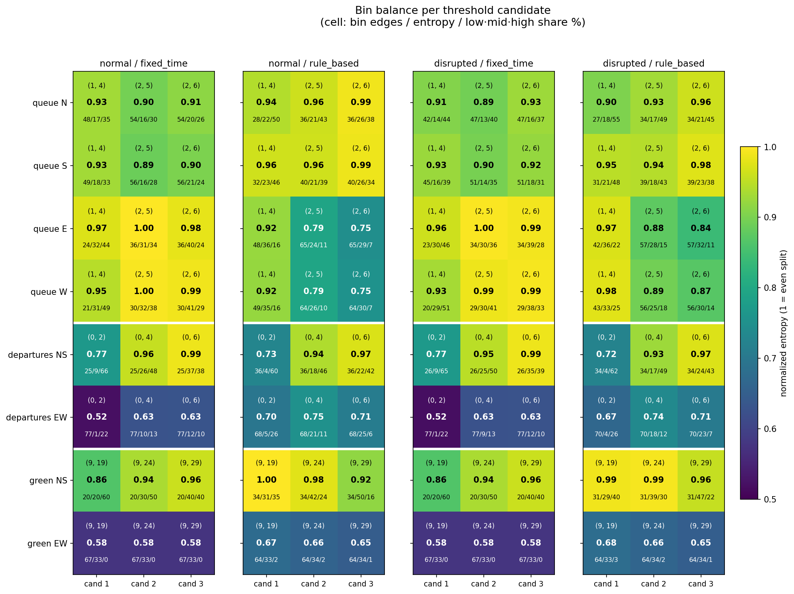

# Traffic-Signal-RL

Traffic signal control at a single four-way intersection with limited queue
observations and temporary reductions in traffic capacity.

**COMP 3106 - Introduction to Artificial Intelligence**

Carleton University, Fall 2026

Individual project by Jaeyoon Lee

## Current status

Implemented:

- A one-second FIFO queue simulator with two signal phases.
- Reproducible Poisson arrival scenarios and temporary capacity disruptions.
- Fixed-time and rule-based controllers.
- Waiting-time, queue-length, throughput, and unfinished-vehicle metrics.
- Current-observation and history-augmented tabular Q-learning with JSON
  Q-table export and greedy evaluation from saved tables.

Normal-traffic fixed-time and rule-threshold tuning have been completed on
validation seeds 100-109, along with normal/disruption saturation measurements.
Both Q-learning variants have completed three 2,000-episode training runs
and matched validation at K = 7. Current-observation tables and curves
are stored in `results/`. History-augmented results are in `results/history/`.

Graphical visualization of the intersection is planned.

## Setup

The project has been tested with Python 3.10.11, NumPy 1.25.2, and
Matplotlib 3.7.2. From the repository root, install the dependencies:

```powershell
python -m pip install -r requirements.txt
```

## Run a comparison

From the repository root, start Python with `python`, then run the following
example. It compares both implemented controllers on normal and disrupted traffic,
using identical arrival records for all four runs.

```python
from src.config import Config, N, S
from src.scenario import make_scenario, with_disruption
from src.env import IntersectionEnv
from src.controllers import FixedTime, RuleBased, run_episode

cfg = Config()

normal = make_scenario(
    seed=42,
    cfg=cfg,
    base=0.15,
    peak=0.65,
    peak_dirs=(N, S),
)
disrupted = with_disruption(
    normal, direction=N, start=600, duration=300, alpha=0.5
)

env = IntersectionEnv(cfg)

for condition, scenario in (("normal", normal), ("disrupted", disrupted)):
    for controller in (FixedTime((45, 10)), RuleBased(threshold=5)):
        result = run_episode(env, controller, scenario)
        print(condition, controller.name)
        print(result["metrics"])
```

`run_episode()` resets the environment and controller for each run. It returns:

- `result["metrics"]`: the final episode statistics.
- `result["logs"]`: one evaluator log per decision interval, including the
  requested action and reward.

Both baseline parameters above were selected on normal-traffic validation seeds
100-109 and are frozen for the normal/disruption comparison. A single
development seed does not establish which controller performs better in general.

The example above compares the two baselines. After training, run
`python -m src.test` from the project root to evaluate the saved Q-learning
policy on normal validation scenario `100`.

### Scenario seeds

| Split | Scenario seeds (inclusive) | Count | Purpose |
| --- | --- | ---: | --- |
| Training | 1000–2999 | 2,000 | Train the Q-learning agents |
| Validation | 100–109 | 10 | Tune baselines on normal scenarios and validate settings on normal/disrupted pairs |
| Test | 3000–3019 | 20 | Evaluate all controllers after settings are fixed |

Vehicle arrivals are generated with `np.random.default_rng(seed)`.
Disruption parameters are sampled with `np.random.default_rng([seed,1])`,
where `1` is fixed tag for the disruption generator. The two generators have seperate states, so sampling a disruption does not advance the arrival generator. Each normal/disrupted pair shares the same arrival list.
Treat this list as read-only.

Each test seed produces a normal scenario and a paired disrupted scenario
with the same vehicle arrivals. All controllers use the same 20 scenario
pairs. Test scenarios are reserved for final evaluation.

These seeds control scenario generation. Q-learning exploration uses separate
random seeds.

### Baseline selection

The baselines were tuned on normal validation scenarios using the weekday
rush-hour profile, with a base arrival rate of 0.15 vehicles/s per approach
and an NS peak of 0.65 vehicles/s per approach. Both baselines use the same
settings under normal and disrupted conditions. The earlier disruption
measurements used a fixed event on approach N from 600 s to 900 s
(end exclusive), with `alpha = 0.5`.

The search used normal scenarios with `base=0.15`, `peak=0.65`, NS peak demand,
and validation seeds 100-109. It evaluated all 28 combinations of NS targets
30-60 s and EW targets 10-25 s, both in 5 s increments. The objective was the
unweighted mean of the ten episode mean completed waits. Every candidate run
finished with zero remaining vehicles, so completed-only censoring did not affect
selection. The selected targets were **(45, 10) s**, with validation mean wait
**13.75 s**. These are the best targets in this grid, not a global optimum.
The (40, 10) alternative has mean wait 13.90 s and mean episode p95 41.24 s,
versus 13.75 s and 47.17 s for (45, 10). We retain (45, 10) because mean wait is
the selection objective; p95 is a secondary reported metric. This is not a tie,
and no p95 tie-break was applied.

Rule thresholds 1-5 used the same ten normal validation scenarios and objective:

| Threshold | Mean episode wait (s) | Mean episode p95 wait (s) |
| --- | ---: | ---: |
| 1 | 16.20 | 40.30 |
| 2 | 15.63 | 39.60 |
| 3 | 13.85 | 34.36 |
| 4 | 13.44 | 33.04 |
| **5 (selected)** | **12.84** | **31.20** |

All 50 runs drained completely. Exact objective ties would use the lower
threshold; no tie occurred. Threshold 5 is best within the requested range,
not a claimed optimum over all possible thresholds. Both baseline settings are
frozen for normal/disruption comparisons; no incident-specific tuning is used.

With 5 s decisions and 3 s clearance, the first NS green lasts 45 s; subsequent
NS/EW greens last 47/12 s, giving a steady 65 s cycle. Targets are not exact
executed green durations. Freeze this normal-tuned pair for the planned paired
normal/disruption evaluation, without retuning for the disruption schedule.

Seed 42 is a previously inspected development example, not a held-out test:

| Controller | Mean wait (s) | p95 wait (s) | Maximum queues (N, S, E, W) |
| --- | ---: | ---: | --- |
| Untuned fixed (30, 30) | 145.45 | 368.3 | 182, 152, 14, 13 |
| Tuned fixed (45, 10) | 14.54 | 60.0 | 17, 17, 24, 16 |
| Rule, threshold 2 | 11.98 | 25.0 | 25, 19, 10, 8 |
| Tuned rule, threshold 5 | 10.94 | 25.0 | 21, 19, 9, 10 |

All four passed all 2,235 arrivals. The tuned rule reduces mean wait by about
24.8% relative to the tuned fixed controller on this development example. Its
N/S maximum queues are still larger. On the ten validation scenarios, tuned
fixed-time averages 13.75 s and the tuned rule 12.84 s. Final conclusions require
held-out multi-seed comparisons. The earlier threshold-2 result is retained for
comparison. Full grid metrics, reward summaries, and saturation counts are
recorded in `output/validation/baseline_validation.json`.

### Observation saturation

Using fixed targets (45, 10), K=7, and paired validation seeds 100-109:

| Condition | N | S | E | W | All step-direction pairs |
| --- | ---: | ---: | ---: | ---: | ---: |
| Normal | 25.64% | 23.53% | 24.38% | 29.10% | 25.66% |
| N half capacity, [600, 900) s | 56.30% | 23.53% | 24.38% | 29.10% | 33.33% |

Saturation means the returned post-step observation equals K (true queue >= K,
including equality). Counts are pooled across seeds, with 3,650 returned steps
per condition: 3,650 samples per direction and 14,600 step-direction pairs.
The denominator includes clearance, drain, and the terminal step; reset is
excluded. A shortened final step still counts as one observation. This measures
the whole episode, not just the incident window. All runs drained. Because the
fixed schedule is unchanged, the other directions have identical observations
in paired normal/disrupted runs. Saturation supports the partial-observation
premise but does not establish that history improves control.

## Check simulation results

Use small, manually specified arrival scenarios to inspect the simulation logs
and compare results with calculations by hand. In particular, check that:

- Total arrivals equal total departures plus the vehicles still queued.
- Vehicles do not depart on red or during clearance.
- Minimum and maximum green constraints are respected.
- Waiting times match known arrival and departure times.
- Controller observations contain only the intended information and queues are
  clipped to the detector cap.
- Repeating a scenario with the same controller produces the same results.

Development checks on November 2, 2026 passed vehicle conservation and equality
between accumulated step waiting and completed plus unfinished vehicle waits,
including nominal approach capacities 1.0, 0.5, and 0.25 vehicle/s with a temporary
half-capacity disruption. Checks also passed for exact observation keys, clipping
above K, repeated-run reproducibility, and a hand-calculated fractional-service
example. One-second checks verified minimum/maximum green, no red departures,
and no discharge during clearance. These were ad hoc checks, not a maintained
automated test suite. Controller performance evaluation remains separate.

## Simulation model

The direction order is **N, S, E, W**. The signal has two phases:

- `PHASE_NS = 0`: north and south may discharge.
- `PHASE_EW = 1`: east and west may discharge.

Each approach has one aggregate FIFO queue representing its lanes. The queue
stores each vehicle's arrival time. Every episode starts with empty queues and
NS green.

Each one-second tick:

1. Applies any forced switch required by the maximum green time.
2. Adds the scheduled arrivals.
3. Records the maximum queue lengths before discharge.
4. Discharges vehicles from green approaches, unless clearance is active.
5. Adds one second of waiting for every remaining vehicle.

A vehicle arriving and departing in the same tick has zero waiting time.
Fractional discharge capacity accumulates while an approach is green and has
waiting vehicles. Unused capacity is discarded when the queue empties or the
phase switches.

During clearance, all approaches stop and the green timer does not advance.
The phase value identifies the upcoming green phase. Maximum green is enforced
every second, including between controller decisions.

### Current configuration

Edit the defaults in `src/config.py` to change the environment settings.

| Setting | Default | Meaning |
| --- | --- | --- |
| Simulation resolution | 1 s | One internal tick |
| `decision_interval` | 5 s | Time between controller decisions |
| `min_green` | 10 s | Minimum green before a requested switch |
| `max_green` | 60 s | Maximum green before a forced switch |
| `clearance_time` | 3 s | All-red interval after switching |
| `inflow_duration` | 1,800 s | Duration of new vehicle arrivals |
| `drain_cap` | 900 s | Maximum additional time to clear remaining vehicles |
| `lanes_per_approach` | 2 | Lanes represented by each approach queue |
| `saturation_flow_per_lane` | 0.5 vehicle/s | Service capacity per lane during green |
| `vehicle_occupancy_m` | 7 m | Effective length per stopped vehicle |
| `detection_range_m` | 50 m | Nominal detector coverage |
| `reward_scale` | 200 | Divisor used to scale the waiting penalty |
| `history_length` | 6 | Number of recent decision intervals retained by the history controller |

The current derived values are:

- `cfg.max_observable()`: floor(50 / 7) = **7 vehicles per approach**.
- `cfg.nominal_capacity()`: 2 x 0.5 = **1 vehicle/s per green approach**.

These are methods and are called with parentheses. The detector cap is an
aggregate observation abstraction; it does not model separate visibility for
each physical lane.

### Arrivals and disruptions

`make_scenario(seed, cfg, base, peak, peak_dirs)` generates the entire arrival
table before an episode. Each row contains the four approach arrival counts for
one second. Selected peak directions follow a trapezoidal arrival-rate profile:
increase during the first third, remain at the peak during the middle third,
and decrease during the final third. Other directions remain at the base rate.

`with_disruption()` creates a new scenario with the same arrival table and an
additional `(direction, start, end, alpha)` event. Treat the shared arrival table
as read-only.

`sample_disruption(scenario, rng)` returns a new scenario with one added
disruption and shares the original arrival table. It samples each parameter
uniformly: direction from N/S/E/W, start time from 450 to 900 seconds, duration
from 150 to 450 seconds, and the remaining-capacity multiplier `alpha` from
0.4 to 0.6. Both endpoints are included for the integer time ranges.

During a disruption, the affected approach's green capacity is
`nominal_capacity() * alpha`. With the default settings, `alpha = 0.5`
reduces capacity to 0.5 vehicles/s. A disruption starts at `start` and ends
just before `end`. Overlapping disruptions on the same approach use the
lowest active `alpha`. Disruption parameters are hidden from the controller.

## Controller interface

A controller implements `act(obs) -> action` and may override `reset()` to clear
episode-specific memory.

- `ACTION_HOLD = 0`: keep the current phase.
- `ACTION_SWITCH = 1`: request a switch to the other phase.

The environment enforces minimum green, maximum green, and clearance constraints.
Controllers receive only the following observation:

| Key | Meaning |
| --- | --- |
| `queue_observation` | Four queue counts, each clipped to K |
| `throughput` | Departures by direction during the previous step |
| `phase` | NS or EW phase |
| `phase_time` | Elapsed green time, excluding clearance |
| `act_mask` | Boolean list: [HOLD allowed, SWITCH allowed] |

`reset(scenario)` returns the initial observation.
`step(action)` returns `(observation, reward, done, info)`.

Reward is:

```python
reward = -wait_increment / cfg.reward_scale
```

`wait_increment` is measured in vehicle-seconds over that step. Run `python -m src.DeltaW` to reproduce the pooled step statistics from
paired normal and disrupted validation scenarios using seeds 100–109.
Waiting increments are measured in vehicle-seconds.

| Controller | Normal mean | Normal p95 | Disrupted mean | Disrupted p95 |
| --- | ---: | ---: | ---: | ---: |
| FixedTime (45, 10) | 86.57 | 174.55 | 205.38 | 656.70 |
| RuleBased (threshold 5) | 80.10 | 179.00 | 194.64 | 662.45 |

Both learning variants use `reward_scale = 200`. The mean reward
magnitude is 0.40–0.43 in normal runs and 0.97–1.03 in disrupted runs.
The disrupted p95 reward magnitude is 3.28–3.31. This divisor keeps the
mean penalty near one under disruption while preserving larger penalties
for steps with more accumulated waiting.

True queue lengths, disruption factors, and cumulative statistics are returned
in evaluator-only `info`; `run_episode()` does not pass them to the controller.
The alpha in `info` describes its reported time boundary, not an average over
the preceding step.

### State discretization

At the default detector cap of K = 7, each approach's observed queue uses
three bins: 0–1, 2–4, and 5–7 vehicles. Departures during the previous
decision interval are summed separately for NS and EW and binned as 0,
1–4, or 5–10 vehicles per axis. Elapsed green uses bins of 0–9, 10–19,
and 20–60 seconds. The state keeps the original phase value.

Candidate boundaries were compared using the observations available to FixedTime (45, 10) and RuleBased (threshold 5) when choosing actions on paired normal and disrupted scenarios from validation seeds 100–109. For queue and departures, we chose the candidate whose smallest bin share across all controller, scenario and direction groups was largest: 13.6% for queue (vs. 10.4% and 6.7%) and 9.4% for departures (vs. 0.8% and 6.1%). Even so, 68–77% of EW departure observations fall in the zero bin under every candidate. A separate zero-departure bin captures intervals with no departures. The first green-time boundary matches the 10-second minimum green; the second, at 20 seconds, gave RuleBased the most even NS split. The 20–60 second bin is rarely reached on the EW axis: never under FixedTime and in 1–3% of RuleBased observations. These boundaries reflect the baseline controllers’ observations and may differ from the states the learning agent visits. The environment’s action mask determines which actions are legal.



Each cell shows the normalized entropy and the percentage of observations
in each of the three bins. The four panels compare FixedTime and RuleBased
on paired normal and disrupted scenarios from validation seeds 100–109.

[View the bin counts used in the figure](validation/bin_counts.csv).

#### Departure history

The history agent tracks the six most recent decision intervals. For each
axis it records the total departures in an interval only if that axis was
green for all five seconds. A full green interval with zero departures is
a valid observation. Red and partially green intervals occupy a slot in
the window but provide no departure count for that axis. The window is
cleared at the start of each episode.

For each axis the agent subtracts the oldest valid count from the newest.
A change of at least +2 vehicles is increasing. A change of −2 vehicles or
less is decreasing. Smaller changes are maintaining. The trend is
unavailable when the window contains fewer than two valid counts.
The two-vehicle threshold corresponds to 0.4 vehicles/s over five seconds.

The current-observation encoding has 4,374 possible state combinations.
Adding one four-category trend per axis raises this upper bound to 69,984.
The first current-observation training run visited 871 distinct states.

### Implemented controllers

**FixedTime** uses separate NS/EW target green durations. It requests a switch
at the first permitted decision when the target is reached. Actual green
durations can exceed the target because decisions occur at fixed intervals;
the environment still enforces maximum green every second.

**RuleBased** compares the observed queue sums of the two axes and switches
when the opposing axis is larger by at least the threshold. If all four counts
are clipped to K, both axis sums are 2K and the rule cannot distinguish the true
queue imbalance.

### Q-learning update

Each state tuple maps to two Q-values in the order `HOLD`, `SWITCH`.
Both values start at zero for unseen states. At each decision,
epsilon-greedy selection uses the current observation's `act_mask`.
Exploration samples uniformly from legal actions. Greedy selection
chooses a legal action with the highest Q-value and breaks ties uniformly.

The agent updates the value of the action it took:

```math
Q(s_t,a_t) \leftarrow Q(s_t,a_t)
+ \alpha \left[y_t - Q(s_t,a_t)\right]
```

The target uses the next observation's action mask on nonterminal steps:

```math
y_t =
\begin{cases}
r_t, & \text{if the episode ends},\\[4pt]
r_t + \gamma \displaystyle\max_{a' \in \mathcal{A}_{\mathrm{legal}}(o_{t+1})}
Q(s_{t+1}, a'), & \text{otherwise}.
\end{cases}
```

Here, $\alpha$ is the learning rate, $\gamma$ is the discount factor,
and $\mathcal{A}\_{\mathrm{legal}}(o\_{t+1})$ is the set of actions allowed
by the next observation's `act_mask`. The reward $r_t$ is defined in the
controller interface above.


### Q-learning training

Each training run uses 2,000 episodes with scenario seeds 1000–2999.
Normal and disrupted episodes alternate, starting with a normal episode
at seed 1000. This gives 1,000 episodes per condition. Disrupted episodes
sample one disruption using `np.random.default_rng([seed, 1])`.

The learning rate is 0.1 and the discount factor is 0.95. Epsilon decays
linearly from 0.20 on the first episode to 0.02 on the last. Each run uses
a separate seed for the agent's action selection.

Run the following commands from the project root:

```powershell
python -m src.train
python -m src.test
```

Each variant trains for 2,000 episodes per agent seed (0, 1, and 2).
Current-observation Q-tables and validation curves are saved in `results/`.
History-augmented Q-tables and validation curves are saved in `results/history/`.
Greedy validation runs before training and every 100 episodes on the same
normal and disrupted scenario pairs from seeds 100–109. Run
`python -m src.plot_learning_curve` to compare the three runs in one figure.

I compared learning rates 0.10 and 0.05 for current-observation Q-learning using validation only. With the
same epsilon schedule (0.20 to 0.02), 0.05 reduced fluctuations and
average wait across late checkpoints. I retained 0.10 because its final
2,000-episode policies had lower mean waits across the three agent seeds
in both normal and disrupted validation scenarios.

### Matched validation at K = 7

All four controllers used the same ten validation scenario seeds (100–109).
For each seed the normal and disrupted scenarios shared identical arrivals.
Each table entry is the average of ten episode mean waits in seconds.
All vehicles departed before the drain limit in every validation run.

Both Q-learning variants used their saved episode-2,000 Q-tables with
epsilon set to zero. The agent seed identifies the training run.
All six policies used evaluation seed 0 for greedy action ties.

| Controller | Training agent seed | Normal mean wait (s) | Disrupted mean wait (s) |
| --- | --- | ---: | ---: |
| FixedTime (45, 10) | — | 13.75 | 32.76 |
| RuleBased (threshold 5) | — | **12.84** | **31.06** |
| Current-observation Q-learning | 0 | 14.69 | 33.78 |
| Current-observation Q-learning | 1 | 13.94 | 32.84 |
| Current-observation Q-learning | 2 | 12.96 | 32.66 |
| **Current-observation mean** | **0–2** | **13.86** | **33.09** |
| History-augmented Q-learning | 0 | 16.37 | 41.82 |
| History-augmented Q-learning | 1 | 15.88 | 39.89 |
| History-augmented Q-learning | 2 | 14.91 | 37.75 |
| **History-augmented mean** | **0–2** | **15.72** | **39.82** |

RuleBased achieved the lowest mean wait in both validation conditions.
At the final checkpoint, adding departure history increased mean wait
for all three training seeds. Averaged across seeds, the increase was
1.86 s under normal demand and 6.73 s under disruption.


### Frozen settings for held-out evaluation at K = 7

After matched validation, I froze the following settings before evaluating
held-out scenario seeds 3000–3019. Both Q-learning variants use the final
checkpoint and the same training budget.

| Setting | Frozen value |
| --- | --- |
| FixedTime green targets | NS 45 s, EW 10 s |
| RuleBased switch threshold | 5 vehicles |
| Q-learning rate and discount | Alpha 0.10, gamma 0.95 |
| Training exploration | Epsilon decreases linearly from 0.20 to 0.02 |
| Training budget | 2,000 episodes per run for agent seeds 0, 1, and 2 |
| Evaluation policy | Greedy with epsilon 0 |
| Reward scale | 200 vehicle-seconds |
| Observed queue bins per approach | 0–1, 2–4, 5–7 vehicles |
| Departure bins per axis | 0, 1–4, 5–10 vehicles per decision interval |
| Elapsed green bins | 0–9, 10–19, 20+ seconds |
| Phase | NS or EW |
| History window | Six decision intervals |
| History trend per axis | Compare the oldest and newest full-green counts in the window. A change of −2 or less is decreasing. A change of +2 or more is increasing. Otherwise the trend is maintaining. Fewer than two valid counts gives unavailable. |


## Evaluation metrics

An episode ends when arrivals have finished and all queues are empty, or when
`inflow_duration + drain_cap` is reached. Call `metrics()` after the episode ends.

| Key | Meaning |
| --- | --- |
| `mean_wait_completed` | Mean wait of vehicles that have departed, in seconds |
| `p95_wait_completed` | 95th percentile of completed waits, in seconds |
| `max_wait_completed` | Longest completed wait, in seconds |
| `total_waiting` | Accumulated waiting across all vehicles, in vehicle-seconds |
| `max_queue` | Maximum queue length for each direction: N, S, E, W |
| `total_arrived` | Total number of arrivals |
| `total_passed` | Total number of departures |
| `remaining` | Number of vehicles still queued at termination |
| `unfinished_ratio` | Remaining vehicles divided by total arrivals; zero if no arrivals |
| `unfinished_wait_so_far` | Accumulated wait of the remaining vehicles |

Completed waiting statistics are `None` if no vehicle has departed. If the drain
cap leaves unfinished vehicles, report their fraction alongside completed-only
waiting statistics. The four maximum queue lengths may occur at different times.

## Project files

| File or directory | Purpose |
| --- | --- |
| `src/config.py` | Environment settings, constants, and scenario seed ranges |
| `src/scenario.py` | Arrival generation and fixed or sampled capacity disruptions |
| `src/env.py` | Queue dynamics, signal constraints, observations, rewards, and metrics |
| `src/controllers.py` | Baseline controllers and evaluation episode runner |
| `src/q_learning.py` | State encoding, Q-learning updates, and Q-table saving and loading |
| `src/train.py` | Training across agent seeds and periodic greedy validation |
| `src/test.py` | Greedy evaluation of the saved Q-table on validation scenario 100 |
| `src/plot_learning_curve.py` | Plot validation curves for the three agent seeds |
| `src/check_bins.py` | Count observations in candidate state bins and export CSV |
| `src/plot_bin_counts.py` | Plot bin occupancy and entropy across boundary candidates |
| `src/check_disruption.py` | Check disruption ranges, reproducibility, and shared arrivals |
| `src/DeltaW.py` | Compare waiting increments on normal and disrupted validation scenarios |
| `results/` | Saved Q-tables, validation learning curves, and generated plots |
| `requirements.txt` | Pinned NumPy and Matplotlib dependencies |

## Scope and limitations

The model does not simulate turns, pedestrians, travel time, lane changes,
finite road storage, or camera image processing. Results apply to the
recurring weekday rush-hour demand profile used in the experiments.
Generalization to other demand profiles remains untested.

Training, validation, and test scenarios use separate seed ranges.
Paired scenarios share arrival records.

Queues have unlimited storage, so long queues do not cause upstream spillback
or prevent new arrivals. Queue counts aggregate two lanes: 182 vehicles at 7 m
per vehicle would occupy about 637 m if evenly divided across lanes, not 1.3 km
of road. The simulator does not model lane allocation or physical queue length.
The 0.5 vehicle/s/lane assumption corresponds to the 1,800 vehicles/hour/lane
approximation in the [FHWA Traffic Signal Timing Manual, Chapter 3](https://ops.fhwa.dot.gov/publications/fhwahop08024/chapter3.htm).
